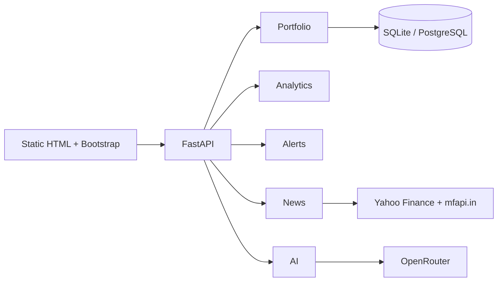

# FinReview

> **Release status (15 November 2026):** `v2.0.0` is the published Foundation Preview. `release/2.0.1` is a **staging release candidate, not a stable release**. The existing public Community demo remains on v1; do not confuse it with the separate testing deployment.
>
> **What's genuinely available in 2.0.1 staging:** The original portfolio dashboard plus authenticated CSV historical research with SMA and breakout observations, an exportable JSON report, and optional per-user broker preference settings. A personal FYERS **non-trading** app owner can test OAuth, an account-scoped read-only profile, and owner-allowlisted read-only history/quote smoke checks, with one successful real FYERS sample observed on 15 November 2026.
>
> **Not publicly supported:** FYERS/Upstox/Zerodha shared live broker login, trading or real orders, automated signals from live prices, completed paper-trade P&L, scheduled hosted digests or redistribution of broker quotes. The optional broker adapters are technical foundations and may require third-party subscriptions or provider authorization. Community users are not required to open a broker account.

> **AI-Assisted Portfolio Intelligence Platform for Indian Investors**


FinReview is an open-source **Community Edition** portfolio intelligence platform designed to demonstrate modern backend architecture, financial analytics, and responsible AI integration.

Unlike traditional portfolio trackers that primarily record transactions, FinReview focuses on helping investors understand **what their portfolio is doing** through deterministic financial analytics complemented by AI-assisted portfolio briefings.

This project is published as a **software engineering showcase**, demonstrating backend engineering, solution architecture, REST API design, financial domain modelling, and AI integration.

---

# 🧪 v2.0.1 Community Edition — Release Candidate

The release candidate extends v1 with transparent, deterministic historical research without forcing users to connect a broker.

| User-facing capability | Current release-candidate status |
| --- | --- |
| Existing portfolio, analytics and news | Retained; final staging regression acceptance pending |
| Research Lab historical CSV upload | Available — user data processed without storage |
| SMA (20/50), 20-bar breakout and ATR context | Available on validated daily OHLCV, historical only |
| Historical research results and JSON export | Available |
| Per-user market-data preferences | Available; **not** an actual broker connection |
| FYERS individual-app OAuth and read-only profile | Private owner-allowlisted staging test only |
| FYERS daily history and quote samples | **Personal staging sample passed (15 Nov 2026):** authenticated profile, 5 daily bars (8–14 Nov), one quote sample. Data quality and redistribution rights unverified. |
| Upstox and Zerodha provider adapters | Experimental; not certified for hosted live usage |
| Signal register / paper-account foundations | Experimental; not a complete simulated trading workflow |
| Real-money order placement | Not implemented or permitted |

**Try the [isolated v2.0.1 staging Research Lab](https://finreview-v201-staging-ui.onrender.com/intelligence.html).** It is intended for testing, not financial advice or public broker credentials. Only the original project maintainer's FYERS non-trading individual app is eligible for the private connectivity test. No third-party users receive that app's market data.

**Release gate:** A green CI build is necessary but insufficient. Read [v2.0.1 readiness evidence](docs/releases/v2.0.1-live-test-readiness.md) for remaining account-isolation, migration/rollback, licensing, broker-backed research and acceptance checks. Until these pass, there is no stable `v2.0.1` tag.

---

# 🌐 Live Demo

**Application**

https://projects.sathishkannan.com/finreview

---

# Why FinReview?

Most portfolio trackers focus on recording transactions.

FinReview focuses on helping investors understand **what their portfolio is doing** by combining deterministic financial analytics with AI-assisted portfolio intelligence.

The project was intentionally designed using a **Static Frontend + FastAPI Backend** architecture to demonstrate scalable backend engineering, clean API design, and responsible AI integration while remaining simple to deploy on low-cost infrastructure.

Rather than relying on AI for financial calculations, FinReview keeps all portfolio analytics deterministic and uses AI only to:

- Explain portfolio behaviour
- Summarise market developments
- Highlight portfolio observations
- Generate informational briefings

This separation improves reliability, transparency, and testability while demonstrating responsible AI integration.

---

# 📸 Screenshots

## Dashboard


---

## Portfolio


---

## Drift Diagnostic


---

## Market News


---

# ✨ Features

## Portfolio Management

- User registration & authentication
- Indian Stocks and Mutual Funds
- Manual BUY / SELL transactions
- CSV transaction import
- Sample portfolio onboarding
- Portfolio valuation
- Holdings management
- User profile management

---

## Portfolio Analytics

- Portfolio valuation
- Invested cost tracking
- Gain/Loss analysis
- XIRR calculation
- Concentration analysis
- Allocation drift diagnostics
- Tax-loss opportunity diagnostics
- Mutual fund overlap availability status (verified holdings provider pending)

---

## Alerts & Market Intelligence

- Price Above alerts
- Price Below alerts
- Portfolio value alerts
- Allocation drift alerts
- Market news aggregation
- News sentiment analysis
- Nifty market context

---

## AI-Assisted Briefings

- Portfolio summaries
- Risk observations
- Portfolio explanation
- OpenRouter integration
- Graceful fallback when AI is unavailable

---

# 🏗 Design Principles

FinReview was intentionally designed around a few core engineering principles.

### Deterministic Before AI

Financial calculations are performed using deterministic algorithms.

AI is used only to explain results—not generate them.

---

### Backend-First Architecture

Business logic resides entirely within the FastAPI backend while the frontend remains lightweight, framework-independent, and deployment-friendly.

---

### Responsible AI Integration

AI-generated content is clearly identified as informational and is never presented as investment advice.

---

### Deployment Simplicity

The application is intentionally designed to run using a static frontend and independently hosted backend, making deployment straightforward on low-cost infrastructure.

---

### Open Architecture

The Community Edition exposes the complete application architecture without artificial feature restrictions, making it suitable for learning, evaluation, and portfolio review.

---

# 🏛 Architecture



Additional documentation:

- docs/architecture.md
- docs/api.md
- docs/database.md

---

# ⚙ Technology Stack

| Layer | Technology |
|---------|------------|
| Backend | Python 3.11, FastAPI, SQLModel |
| Frontend | HTML5, Bootstrap 5, Vanilla JavaScript |
| Database | SQLite (Development), PostgreSQL (Production) |
| Charts | Chart.js |
| AI | OpenRouter |
| Market Data | Yahoo Finance & mfapi.in |
| Deployment | Render + Static Hosting |

---

# 📂 Repository Structure

```text
backend/
    FastAPI backend

frontend/
    Static HTML, CSS & JavaScript

docs/
    Technical documentation

tests/
    Backend regression tests

scripts/
    Utility scripts

Dockerfile

docker-compose.yml

render.yaml
```

---

# 🚀 Quick Start

## Backend

```bash
cd backend

python -m venv .venv

pip install -r requirements.txt

copy ..\.env.example .env

# Set AUTH_SECRET_KEY in .env before starting (at least 32 random bytes).
# Generate a value: python -c "import secrets; print(secrets.token_urlsafe(48))"

uvicorn main:app --reload
```

Backend

```
http://localhost:8000
```

---

## Frontend

```bash
cd frontend

python -m http.server 8080
```

Frontend

```
http://localhost:8080
```

---

# 🐳 Docker

```bash
copy .env.example .env

docker compose up --build
```

---

# ☁ Deployment

Recommended deployment architecture

| Component | Platform |
|-----------|----------|
| Frontend | Static Hosting (MilesWeb) |
| Backend | Render |
| Database | PostgreSQL |
| AI | OpenRouter |

---

# 🔐 Configuration

Important environment variables

```
DATABASE_URL

AUTH_SECRET_KEY

OPENROUTER_API_KEY

CORS_ALLOW_ORIGINS

LOG_LEVEL
```

Refer to:

```
.env.example
```

---

# 🛡 Security

- Open-source Community Edition
- Informational only — not investment advice
- Lightweight HMAC-signed bearer authentication
- SQLite for development
- PostgreSQL recommended for hosted deployments
- Secrets managed using environment variables

---

# 🎯 Engineering Objectives

FinReview was built to demonstrate practical software engineering across multiple disciplines:

- Solution Architecture
- Backend Engineering
- REST API Design
- Financial Domain Modelling
- AI Integration
- Authentication & Security
- Database Design
- Deployment Architecture
- Production-style Engineering Practices
- Technical Documentation

---

# 📚 Documentation

Additional technical documentation is available under the **docs/** directory.

- Architecture
- API
- Database
- Deployment

---

# 🗺 Roadmap

See:

```
ROADMAP.md
```

---

# 🤝 Contributing

Please refer to:

- CONTRIBUTING.md
- CODE_OF_CONDUCT.md

---

# 📄 License

MIT License

---

# 👨‍💻 Author

**Sathishkannan**

Backend Engineer • AI Integration • Solution Architecture • Financial Technology

🌐 Portfolio  
https://sathishkannan.com

🚀 Live Demo  
https://projects.sathishkannan.com/finreview

💻 GitHub  
https://github.com/sathishkannan-sakthivel

💼 LinkedIn  
https://www.linkedin.com/in/ssathishkannan