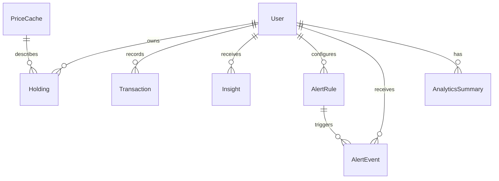

# Database Schema

FinReview uses SQLModel on top of SQLAlchemy. SQLite is supported for local development; PostgreSQL is recommended for deployment.

## Core Tables

- `user`: Account, profile, target allocation, drift sensitivity, and refresh metadata.
- `holding`: Current quantity and average cost per user and symbol.
- `transaction`: Buy/sell ledger with idempotency hash.
- `analyticssummary`: Valuation, cost, XIRR, concentration, and JSON diagnostics.
- `insight`: AI-generated and logic-generated insight records.
- `newsarticle`: Market news with category and sentiment.
- `alertrule`: User-defined alert rules.
- `alertevent`: Alert evaluation results.
- `pricecache`: Latest known price and display name by symbol.
- `newshash`: News de-duplication hashes.

## Transaction guardrails

Migration `20261018142151_transaction_guardrails.sql` adds one holding per user
and symbol, nonnegative holding balances/costs, and positive transaction
quantities/prices. PostgreSQL checks also reject NaN and infinities. It was
applied and verified on finreview-api with all verification data rolled back.

The FastAPI service connects directly to PostgreSQL and enforces account
ownership from its bearer token. Existing RLS remains enabled without browser
access policies, intentionally denying Data API access to these tables. This
uses custom integer user IDs, not Supabase Auth UUIDs. The advisor's
[RLS enabled with no policy](https://supabase.com/docs/guides/database/database-linter?lint=0008_rls_enabled_no_policy)
notice is expected for this backend-only access model. No permissive policies
were added. The existing
[unindexed alert foreign key](https://supabase.com/docs/guides/database/database-linter?lint=0001_unindexed_foreign_keys)
notice is outside this transaction change.

The service locks the owning user before modifying holdings, including new
symbols, and commits ledger and holdings in one transaction. SQLite uses an
immediate write transaction for development. Price-provider lookups occur
before the account lock. Derived analytics and alert evaluation occur after
the trade commit and report refresh failure separately.
